# Weekly report: C = 32 benchmark, GRAND-in-the-loop training, and GRAND at the receiver

Safaa Salman · 28 October 2026 · progress since the meeting of 25 October · code on branch `grand-implementation`, how to rerun everything is in the [README](../README.md); first-round results in [grand_results.md](grand_results.md).

## Summary

This week I built the new trainer and evaluation pipeline, trained two C = 32 models on Colab (a benchmark with a proper learning-rate schedule, and the same recipe with GRAND inside the training loop), and evaluated three models under five channel conditions, seven SNRs and five receivers on 24 Kodak patches with four metrics. I also ran the LLR study, the imperfect-CSI conditions, a guess-budget study, and exported the test set for the bit-exact check against Duffy's MATLAB code.

The result is negative but clear. The benchmark gained +0.75 dB over the old checkpoint. GRAND did not: the CRC(128,112) code plus ORBGRAND adds at most +0.08 dB PSNR on AWGN, the apparent gains in fading come from the interleaver and not from the code, and the model trained with GRAND in the loop is 0.1 to 0.24 dB worse than the benchmark with every receiver. The only measurable win for GRAND is for receivers that deliver hard bits. The mechanism is that the semantic decoder already tolerates scattered bit errors, so there is almost nothing left for a channel code to repair. The MATLAB bit-exact check is the one request still open.

## 1. Status of the requests from the last meeting

| # | Request | Done this week | Status |
| --- | --- | --- | --- |
| 1 | Pick one C and train it properly (schedule, no fixed LR) as the benchmark | C = 32, 30k steps, warmup + cosine LR, random SNR per batch; +0.75 dB over the old checkpoint | done, section 3 |
| 2 | Train with GRAND in the loop and compare with / without | Same recipe with CRC + ORBGRAND in the forward pass; evaluated against the benchmark | done, section 4; result negative |
| 3 | Use Duffy's MATLAB GRAND, not a Python replica | MATLAB bridge and bit-exact test set (740 blocks) exported; Octave run crashed; MATLAB run not yet done. All numbers here use the Python port | open, section 10 |
| 4 | Imperfect CSI and SNR from 0 dB | SNR 0 to 12 dB; SNR misestimate ±3 dB; channel-estimate error in fading | done, section 6 |
| 5 | A better semantic metric than PSNR | MS-SSIM, LPIPS and CLIP similarity computed for every run | done, section 8 |
| 6 | Plot the LLRs under different channels | LLR histograms and a summary per condition | done, section 9 |

## 2. Setup common to all experiments

**System.** BitSemCom with C = 32 bits per token: a 256×256 patch becomes 8192 bits, sent as QPSK symbols. The semantic decoder takes the probability that each bit is a 1, computed from the channel LLR. The coded link adds a CRC(128,112) code (Koopman polynomial 0x9eb2, 16 parity bits per 112 data bits, rate 0.875) after the bit mapper, with a fixed pseudo-random interleaver over the patch. The 8192 bits are padded with 96 zeros to 74 blocks of 112, so a patch costs 9472 coded bits and 4736 QPSK symbols instead of 4096: 16% more channel uses. The receiver decodes each block with 1-line ORBGRAND and gives up after 2000 codebook guesses. An abandoned block is passed on as the plain soft values (soft fallback), so GRAND can only hurt through miscorrections, blocks "repaired" to the wrong codeword.

**Models.**

| Model | Training | GRAND in the loop | PSNR with perfect bits (dB) |
| --- | --- | --- | --- |
| stage2 | the old checkpoint, fixed LR, stopped at about 24k steps | no | 23.46 |
| bench | 30k steps, warmup + cosine LR 1e-4 to 1e-6, SNR per batch U[0, 10] dB | no | 24.22 |
| grand | identical recipe and starting weights | yes: CRC(128,112) + ORBGRAND, budget 2000, soft fallback | 24.02 |

**Channel conditions.** AWGN with perfect CSI; AWGN where the receiver's SNR estimate is 3 dB too high or 3 dB too low; block Rayleigh fading with one fade per token (8 QPSK symbols); the same fading with a channel-estimate error of variance 0.1. Es/N0 per symbol from 0 to 12 dB in 2 dB steps.

**Receivers.** Perfect bits (the ceiling), the plain BitSemCom soft receiver, the same with the interleaver, hard 0/1 decisions, and the coded receiver (interleaver + CRC + ORBGRAND, soft fallback).

**Protocol.** 24 Kodak 256×256 patches. For a given image and SNR, every receiver sees the same semantic bits and the same channel noise, so every comparison is a paired difference averaged over the 24 images, reported with the standard error of that mean and the number of images on which the first receiver wins. Metrics: PSNR (headline), MS-SSIM, LPIPS (AlexNet), CLIP ViT-B/32 cosine similarity.

**Compute.** Colab Pro. Benchmark run on an L4 at 0.70 s/step (about 5.8 h); GRAND run on an A100 at 0.47 s/step (about 3.9 h, of which 0.19 s/step is ORBGRAND in a process pool). The main evaluation sweep is 12,600 image evaluations (3 models × 5 conditions × 7 SNRs × 5 receivers × 24 images).

## 3. Experiment 1: benchmark retraining with a proper schedule

**Setup.** Start from the stage2 checkpoint. AdamW, peak LR 1e-4, 500 warmup steps, cosine decay to 1e-6 over 30k steps, batch 16, DIV2K crops with flips, gradient clipping 1.0, bf16 for the Swin blocks. SNR drawn per batch from U[0, 10] dB (the old code drew one integer SNR per epoch). Validation every 1000 steps on the 24 Kodak patches at 0, 3, 6 and 10 dB; best checkpoint kept.

**Result.** The validation score (mean PSNR over the four SNRs, model's own receiver) rose from 23.07 to 23.65 dB and was still rising slowly at 30k steps. On the full evaluation, bench beats stage2 with the plain soft receiver at every SNR:

| Es/N0 (dB) | AWGN stage2 | AWGN bench | gain | fading stage2 | fading bench | gain |
| --- | --- | --- | --- | --- | --- | --- |
| 0 | 22.43 | 22.70 | +0.27 ± 0.04 | 21.69 | 21.83 | +0.14 ± 0.07 |
| 2 | 22.84 | 23.30 | +0.46 ± 0.05 | 22.14 | 22.41 | +0.27 ± 0.09 |
| 4 | 23.20 | 23.79 | +0.59 ± 0.05 | 22.53 | 22.95 | +0.42 ± 0.07 |
| 6 | 23.35 | 24.07 | +0.72 ± 0.06 | 22.88 | 23.45 | +0.58 ± 0.05 |
| 8 | 23.44 | 24.18 | +0.75 ± 0.05 | 23.08 | 23.64 | +0.57 ± 0.05 |
| 12 | 23.46 | 24.22 | +0.75 ± 0.06 | 23.33 | 24.02 | +0.69 ± 0.05 |

*PSNR in dB, plain soft receiver, perfect CSI; gain = bench minus stage2, paired over 24 images, ±1 s.e.*

The one place bench loses is the hard-decision receiver at 0 dB (−0.35 dB AWGN, −0.59 dB fading): stage2 was trained down to −3 dB and tolerates harsher inputs. Note for later comparisons: stage2 and bench differ in training SNR range (−3 to 6 dB vs 0 to 10 dB), not only in schedule.

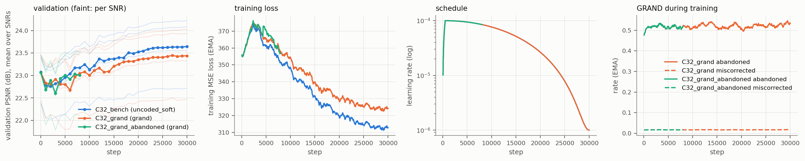

*Figure 1. Training curves of both runs. Validation PSNR (mean over 0, 3, 6, 10 dB; faint lines per SNR), training MSE, the LR schedule, and the abandonment and miscorrection rates ORBGRAND reported inside the loop. The bench run (blue) ends 0.2 dB above the grand run (orange). The green curve is the first grand attempt, stopped at 8000 steps by early stopping and restarted with patience off.*

## 4. Experiment 2: training with GRAND in the loop

**Setup.** Same recipe, data, schedule, SNR range and starting weights as bench. In every training step the bits go through CRC encoding, QPSK, the channel, LLR computation and ORBGRAND (budget 2000, soft fallback, interleaver on) before the semantic decoder. ORBGRAND is not differentiable; its forward output is used as is, and the backward pass uses the Jacobian of the uncoded soft channel, so both runs share one gradient path and differ only in the forward signal. ORBGRAND runs in a process pool over the images of a batch.

**Result during training.** The GRAND statistics inside the loop never moved: about 50% of blocks abandoned (48 to 62% depending on the batch SNR) and 1.5% miscorrected, from step 50 to step 30,000. The training loss stayed about 3% above bench's for the whole run.

| Run | start | best score | at step | 0 dB | 3 dB | 6 dB | 10 dB | perfect bits |
| --- | --- | --- | --- | --- | --- | --- | --- | --- |
| bench (plain soft receiver) | 23.07 | 23.65 | 30,000 | 22.72 | 23.56 | 24.08 | 24.22 | 24.22 |
| grand (its own coded receiver) | 23.07 | 23.45 | 27,000 | 22.50 | 23.34 | 23.94 | 24.01 | 24.04 |

*Validation PSNR in dB on the 24 Kodak patches, AWGN; score = mean over the four SNRs.*

**Result on the full evaluation.** The GRAND-trained model is worse than bench with every receiver, in every condition: on AWGN by 0.09 dB (0 dB) to 0.24 dB (4 dB) with its own coded receiver, by 0.17 to 0.22 dB with perfect bits, and by 0.16 to 0.23 dB with the plain soft receiver (s.e. 0.02 to 0.04). In fading the gap at 0 dB is not significant (+0.11 ± 0.10) and from 2 dB on it is −0.13 to −0.24 dB. Its coding gain is the same as bench's (coded minus interleaver-only at 6 dB AWGN: +0.10 ± 0.02 vs +0.08 ± 0.01), so the decoder did not learn to exploit ORBGRAND's output either.

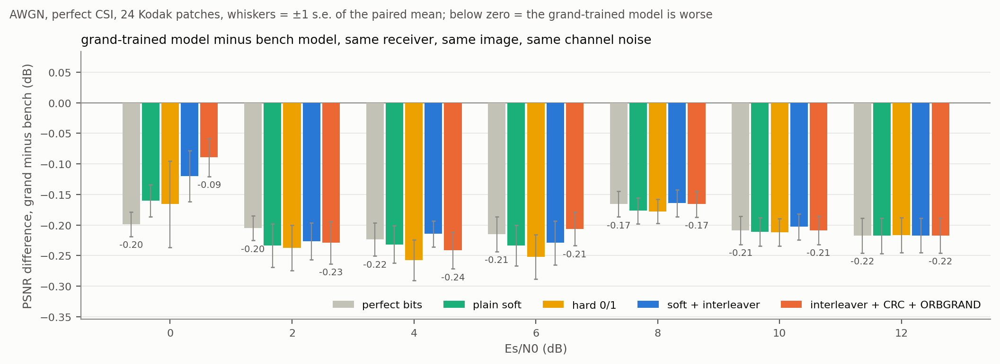

*Figure 2. GRAND-trained model minus benchmark on AWGN, same receiver, same image, same noise. Every bar is below zero, including the perfect-bit receiver (grey), and the coded receiver (orange) is no closer to zero than the others.*

**Reading.** The gap is the same with perfect bits as with the GRAND receiver, so this is a worse autoencoder, not a model specialised to its decoder. Two reasons are visible in the logs. The encoder cannot steer which blocks decode, because the QPSK power is fixed and the abandonment rate stayed flat, so only the decoder could have adapted, and it did not. And the training loss stayed 3% higher although half of the blocks arrived error-free, which points at the gradient surrogate used to train through the non-differentiable decoder. A first attempt at this run was stopped at 8000 steps by early stopping; the restart reported here ran the full 30k steps.

## 5. Experiment 3: the code plus ORBGRAND at the receiver (budget 2000)

This is the main sweep: for each model and condition, the coded receiver against the plain soft receiver and against the plain receiver with the same interleaver and no code. The second comparison isolates the code itself. The guess budget is 2000, the budget used in training (the 100,000 budget is in section 7).

### 5.1 AWGN

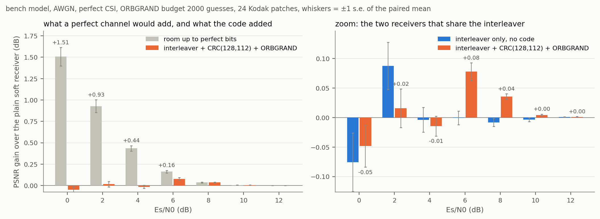

*Figure 3. Bench model on AWGN. Left: the grey bars are how much PSNR is still available at each SNR if every bit arrived correctly; the orange bars are what the code plus ORBGRAND actually gained. Right: zoom on the two receivers that share the interleaver. Whiskers are ±1 s.e. of the paired mean.*

| Es/N0 (dB) | perfect bits | plain soft | + interleaver | + interleaver + code | code minus interleaver-only (wins) | abandoned | miscorrected | avg. guesses |
| --- | --- | --- | --- | --- | --- | --- | --- | --- |
| 0 | 24.21 | 22.70 | 22.63 | 22.66 | +0.03 ± 0.05 (15/24) | 97.6% | 2.4% | 2048 |
| 2 | 24.23 | 23.30 | 23.39 | 23.31 | −0.07 ± 0.04 (12/24) | 97.0% | 3.0% | 2040 |
| 4 | 24.23 | 23.79 | 23.79 | 23.78 | −0.01 ± 0.02 (11/24) | 91.0% | 3.0% | 1972 |
| 6 | 24.23 | 24.07 | 24.07 | 24.15 | +0.08 ± 0.01 (20/24) | 24.7% | 0.7% | 725 |
| 8 | 24.22 | 24.18 | 24.17 | 24.22 | +0.04 ± 0.01 (24/24) | 0.1% | 0.0% | 10 |
| 10 | 24.21 | 24.21 | 24.21 | 24.21 | +0.01 ± 0.00 (19/24) | 0% | 0% | 1 |
| 12 | 24.22 | 24.22 | 24.22 | 24.22 | +0.00 ± 0.00 (13/24) | 0% | 0% | 1 |

*Bench model, PSNR in dB, perfect CSI. Abandoned and miscorrected are fractions of the 74 blocks per patch; avg. guesses is the mean number of codebook queries per block (a block may use up to 15% more than the nominal budget because the check is per weight level, as in Duffy's code).*

**Reading.** Where ORBGRAND can decode (6 dB and up) the room up to perfect bits is 0.16 dB or less, and the code recovers half of it at 6 dB and all of it at 8 dB. Below 6 dB the decoder gives up on 91 to 98% of the blocks and miscorrects 2 to 3%, so the coded receiver is level with the plain one or slightly below. The coded receiver wins on 20 of 24 images at 6 dB and 24 of 24 at 8 dB, but by 0.08 and 0.04 dB. The stage2 and grand models show the same shape (+0.04 and +0.10 dB over interleaver-only at 6 dB, nothing elsewhere).

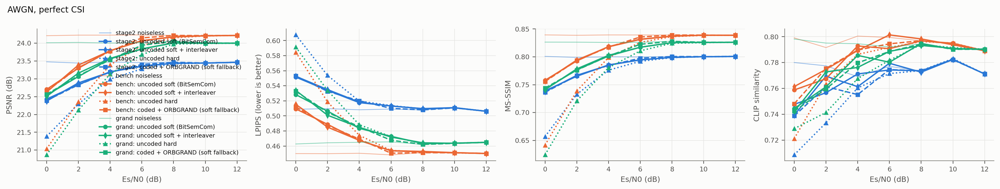

*Figure 4. The same runs as absolute quality: PSNR, LPIPS, MS-SSIM and CLIP similarity against Es/N0 on AWGN. Colour is the model, line style is the receiver, thin flat lines are the perfect-bit ceilings. The coded receiver (dashed, squares) lies on top of the plain soft receiver (solid, circles) at every SNR; only the hard-decision receiver (dotted, triangles) is visibly worse.*

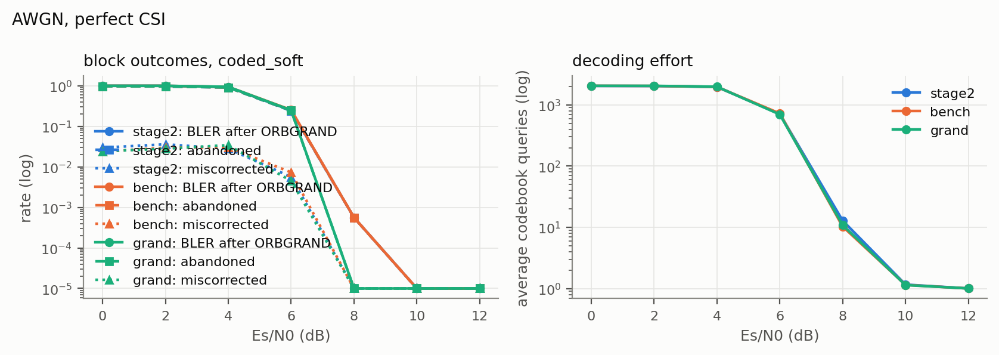

*Figure 5. What ORBGRAND did with the blocks on AWGN (log scale): block error rate after decoding, fraction abandoned, fraction miscorrected, and the average number of guesses. Up to 4 dB nearly every block is abandoned at the 2000-guess budget; from 8 dB nearly every block decodes within about 10 guesses.*

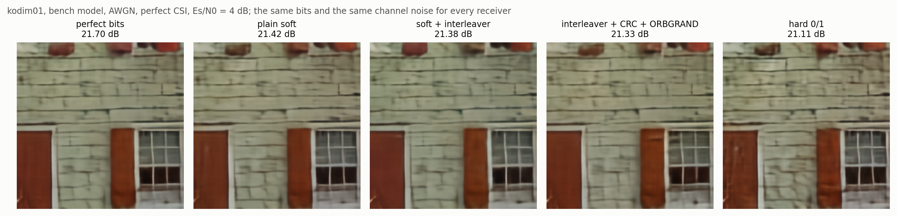

*Figure 6. One patch at 4 dB AWGN, same bits and same noise for every receiver. The four soft-input receivers are visually indistinguishable; the hard-decision receiver loses 0.3 dB.*

### 5.2 Block Rayleigh fading

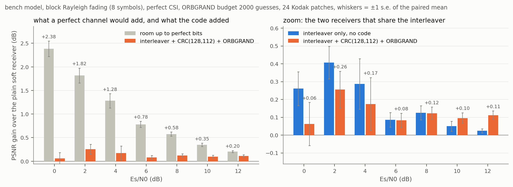

*Figure 7. Bench model in block Rayleigh fading (one fade per token). Left: room up to perfect bits (grey) against the coded gain (orange). Right: the interleaver alone (blue) against the interleaver plus code (orange). Both coloured series are measured against the plain soft receiver without an interleaver.*

| Es/N0 (dB) | perfect bits | plain soft | + interleaver | + interleaver + code | code minus interleaver-only (wins) | abandoned | miscorrected | avg. guesses |
| --- | --- | --- | --- | --- | --- | --- | --- | --- |
| 0 | 24.21 | 21.83 | 22.09 | 21.89 | −0.20 ± 0.07 (6/24) | 96.7% | 3.3% | 2017 |
| 2 | 24.23 | 22.41 | 22.82 | 22.67 | −0.15 ± 0.05 (5/24) | 96.4% | 3.6% | 2017 |
| 4 | 24.23 | 22.95 | 23.23 | 23.12 | −0.11 ± 0.06 (10/24) | 97.2% | 2.8% | 2019 |
| 6 | 24.23 | 23.45 | 23.54 | 23.54 | −0.00 ± 0.05 (11/24) | 96.3% | 3.4% | 2009 |
| 8 | 24.22 | 23.64 | 23.77 | 23.77 | −0.00 ± 0.03 (12/24) | 93.5% | 2.8% | 1970 |
| 10 | 24.21 | 23.87 | 23.92 | 23.96 | +0.05 ± 0.02 (17/24) | 68.1% | 2.4% | 1581 |
| 12 | 24.22 | 24.02 | 24.04 | 24.13 | +0.09 ± 0.02 (20/24) | 31.6% | 1.2% | 888 |

*Bench model, PSNR in dB, block Rayleigh fading with one fade per 8 symbols, perfect CSI.*

**Reading.** In fading the plain receiver loses up to 2.4 dB, because a deep fade wipes out whole tokens. The interleaver alone recovers +0.26 / +0.41 / +0.29 dB at 0 / 2 / 4 dB by spreading those errors over the patch. The coded receiver uses the same interleaver and sits below it at 0 to 4 dB (miscorrections) and level with it at 6 to 8 dB. Only from 10 dB, where abandonment falls from 97% to 68% and then 32%, does the code add +0.05 to +0.09 dB on top of the interleaver. Against the plain receiver the coded numbers read +0.06 to +0.26 dB; that is the interleaver, not the code.

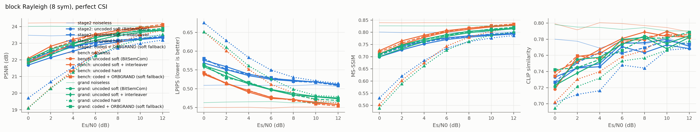

*Figure 8. Absolute quality in block Rayleigh fading. The two receivers with an interleaver (diamonds and squares) sit a few tenths of a dB above the plain receiver (circles) and on top of each other; the hard-decision receiver loses 2 to 3 dB at low SNR.*

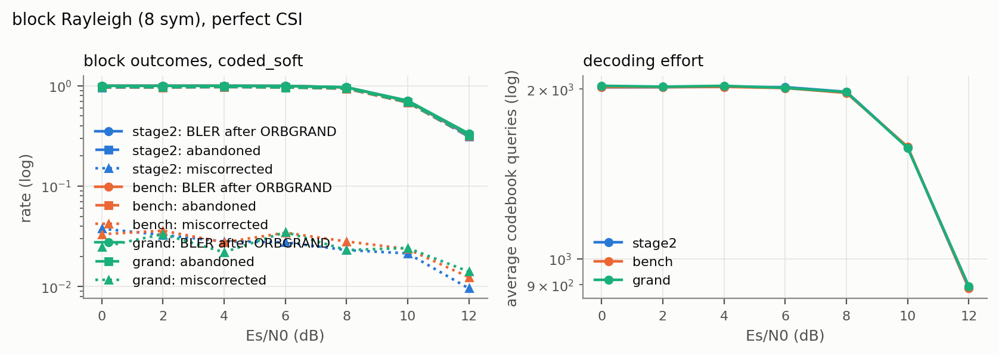

*Figure 9. ORBGRAND block outcomes in fading. Up to 8 dB about 97% of blocks are abandoned at the 2000-guess budget; abandonment only falls to 68% at 10 dB and 32% at 12 dB, which is where the small coded gain in Figure 7 appears.*

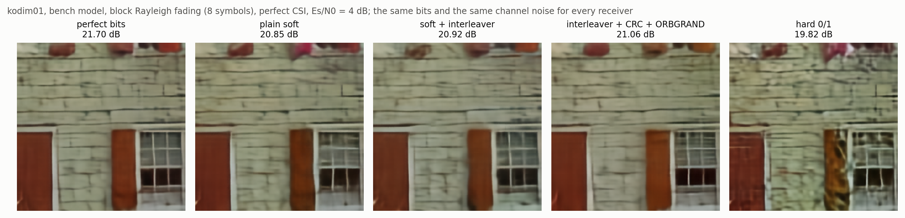

*Figure 10. The same patch at 4 dB in block fading. The interleaved receivers are 0.1 to 0.2 dB above the plain one; the hard-decision receiver loses 1 dB and shows the damage of whole faded tokens.*

### 5.3 Hard-decision receivers

| Receiver | AWGN 0 dB | AWGN 6 dB | fading 0 dB | fading 6 dB |
| --- | --- | --- | --- | --- |
| plain soft | 22.70 | 24.07 | 21.83 | 23.45 |
| hard 0/1 | 21.03 | 23.94 | 19.13 | 22.45 |
| interleaver + code, soft fallback | 22.66 | 24.15 | 21.89 | 23.54 |

*Bench model, PSNR in dB.*

Hard decisions cost 1.7 dB at 0 dB AWGN and 2.7 dB at 0 dB fading, because a faded or noisy bit arrives as "probability 0.5" and the soft decoder treats it as unknown, while a hard decision throws that away. Two things follow. First, an earlier working note that "coded + ORBGRAND beats hard decisions by +1.6 dB (AWGN) and +2.8 dB (fading)" is correct but measures the soft fallback, not GRAND: at 0 dB 97% of the blocks are abandoned and arrive as soft values. Second, the honest hard-bit number is the first-round comparison of the code *with hard fallback* against hard decisions: +0.09 dB at 6 dB AWGN, +0.36 dB at 6 dB and +0.23 dB at 10 dB in fading (C = 16). That is the real gain GRAND offers a receiver that can only deliver bits.

## 6. Experiment 4: imperfect CSI

**Setup.** Three error models on the bench model, each compared with its perfect-CSI twin, receiver by receiver: the receiver scales its LLRs with an SNR 3 dB too high; with an SNR 3 dB too low; and in block fading the receiver equalises with an estimate h + e, e ~ CN(0, 0.1).

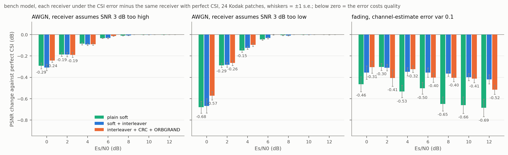

*Figure 11. PSNR change of each receiver under the CSI error, against the same receiver with perfect CSI. Bench model; below zero means the error costs quality.*

**Result.** An SNR over-estimate costs the plain soft receiver 0.29 dB at 0 dB and nothing from 8 dB on; an under-estimate costs 0.68 dB at 0 dB, 0.29 at 2 dB, 0.15 at 4 dB and nothing from 8 dB on. The coded receiver pays almost the same below 6 dB (0.24 and 0.57 dB at 0 dB) because its abandoned blocks fall back to the same miscalibrated soft values, and nothing from 6 dB on. A channel-estimate error of variance 0.1 in fading costs the plain receiver 0.46 to 0.69 dB, growing with SNR, the interleaved receiver 0.31 to 0.42 dB, and the coded receiver 0.31 to 0.52 dB; with the estimate error the block failure rate stays at 94 to 98% up to 12 dB, so the code never decodes and never beats the interleaver alone (section 9 shows why).

**Reading.** The LLR study (section 9) shows that ORBGRAND itself is immune to the SNR misestimate: its guessing order depends only on the ranking of the LLRs, which a scale error does not change. This does not show in the image quality because the coded receiver's quality below 6 dB is set by the abandoned blocks, which are soft values and inherit the miscalibration. The argument for GRAND under imperfect CSI only holds where it actually decodes.

## 7. Experiment 5: guess budget 2000 vs 100,000

**Setup.** The main sweep uses the training budget of 2000 guesses. A second sweep (bench, grand and stage2; AWGN and fading) lets ORBGRAND guess up to 100,000 times per block.

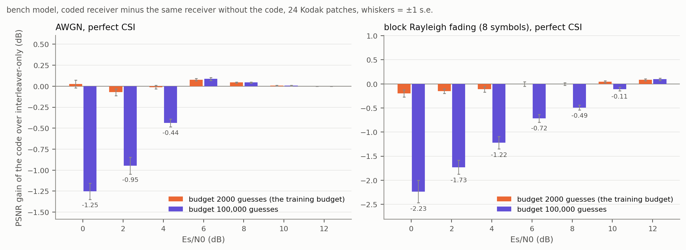

*Figure 12. Gain of the code over the interleaver-only receiver at the two budgets, bench model.*

| Es/N0 (dB) | AWGN, budget 2000: gain / abandoned / miscorrected | AWGN, budget 100,000 | fading, budget 2000 | fading, budget 100,000 |
| --- | --- | --- | --- | --- |
| 0 | +0.03 / 98% / 2% | −1.25 / 21% / 79% | −0.20 / 97% / 3% | −2.23 / 19% / 81% |
| 2 | −0.07 / 97% / 3% | −0.95 / 21% / 79% | −0.15 / 96% / 4% | −1.73 / 21% / 79% |
| 4 | −0.01 / 91% / 3% | −0.44 / 16% / 67% | −0.11 / 97% / 3% | −1.22 / 21% / 79% |
| 6 | +0.08 / 25% / 1% | +0.09 / 1% / 7% | −0.00 / 96% / 3% | −0.72 / 19% / 80% |
| 8 | +0.04 / 0% / 0% | +0.04 / 0% / 0% | −0.00 / 94% / 3% | −0.49 / 16% / 70% |
| 12 | +0.00 / 0% / 0% | +0.00 / 0% / 0% | +0.09 / 32% / 1% | +0.10 / 2% / 10% |

*Gain in dB of the coded receiver over the interleaver-only receiver, bench model, with the fraction of blocks abandoned and miscorrected.*

**Reading.** A larger budget turns abandoned blocks into miscorrected ones. Below 6 dB AWGN and below 10 dB fading, 67 to 81% of the blocks come back as confidently wrong codewords and the coded receiver loses 0.4 to 1.3 dB (AWGN) and 0.5 to 2.2 dB (fading). Where the code works (6 to 8 dB AWGN, 12 dB fading) the two budgets give the same gain. With 16 parity bits the code is simply too weak for the error rates below 6 dB, and the budget cannot fix that; it only decides whether a failed block is declared (abandonment, harmless) or hidden (miscorrection, harmful).

## 8. Experiment 6: semantic metrics beyond PSNR

**Setup.** MS-SSIM, LPIPS (AlexNet) and CLIP ViT-B/32 cosine similarity were computed for every image of the main sweep, next to PSNR.

| Condition, Es/N0 | PSNR (dB) | MS-SSIM | LPIPS (lower is better) | CLIP similarity |
| --- | --- | --- | --- | --- |
| AWGN 6 dB | +0.078 ± 0.013 | +0.004 ± 0.001 | −0.003 ± 0.001 | −0.007 ± 0.004 |
| AWGN 8 dB | +0.044 ± 0.006 | +0.002 ± 0.000 | −0.002 ± 0.001 | −0.001 ± 0.001 |
| fading 0 dB | −0.198 ± 0.074 | −0.005 ± 0.003 | +0.005 ± 0.004 | −0.005 ± 0.010 |
| fading 2 dB | −0.152 ± 0.046 | −0.009 ± 0.002 | −0.002 ± 0.004 | +0.007 ± 0.010 |
| fading 12 dB | +0.088 ± 0.020 | +0.003 ± 0.001 | −0.004 ± 0.001 | +0.003 ± 0.004 |

*Bench model, coded receiver minus interleaver-only receiver, paired over 24 images, ±1 s.e.*

**Reading.** MS-SSIM and LPIPS agree with PSNR in sign wherever PSNR moves by more than 0.03 dB; the exceptions are inside their standard errors. CLIP similarity differences sit inside a standard error of about 0.01 everywhere: 24 images are too few for it to separate any two receivers. For the thesis I suggest PSNR plus LPIPS as the reported pair, with CLIP only if we evaluate on a few hundred images. Across all runs the ordering of receivers is the same under PSNR, MS-SSIM and LPIPS (Figures 4 and 8), so none of the new metrics changes the conclusion.

## 9. Experiment 7: LLR study

**Setup.** stage2 model, 4 Kodak patches, SNR 0 / 4 / 8 / 12 dB, six conditions (the five above plus per-symbol fading), with a large guess budget so that the decoder outcome is not limited by abandonment. Per condition: histograms of the channel LLRs split by the true bit, of the probability the decoder sees, and of the same after GRAND; the figure below is the summary.

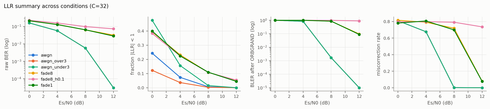

*Figure 13. Raw bit error rate, fraction of weak LLRs (|LLR| < 1), block error rate after ORBGRAND, and miscorrection rate per condition. The three AWGN curves lie exactly on top of each other in every panel except the second.*

| Condition | Es/N0 (dB) | raw BER | mean abs. LLR | fraction abs. LLR < 1 | BLER after ORBGRAND |
| --- | --- | --- | --- | --- | --- |
| AWGN, perfect CSI | 0 | 0.159 | 2.3 | 0.24 | 1.00 |
| AWGN, SNR assumed 3 dB too high | 0 | 0.159 | 4.7 | 0.12 | 1.00 |
| AWGN, SNR assumed 3 dB too low | 0 | 0.159 | 1.2 | 0.48 | 1.00 |
| AWGN, perfect CSI | 8 | 0.0057 | 12.6 | 0.007 | 0.0017 |
| AWGN, SNR assumed 3 dB too high | 8 | 0.0057 | 25.2 | 0.003 | 0.0017 |
| AWGN, SNR assumed 3 dB too low | 8 | 0.0057 | 6.3 | 0.016 | 0.0017 |
| block fading, perfect CSI | 12 | 0.032 | 30.5 | 0.053 | 0.096 |
| block fading, channel-estimate error 0.1 | 12 | 0.073 | 30.8 | 0.054 | 0.895 |

**Reading.** Two mechanisms, both confirmed by the image results. An SNR misestimate rescales the LLRs (mean |LLR| 1.2 / 2.3 / 4.7 at 0 dB for under / correct / over) and changes the fraction of near-erasures the soft decoder sees, but leaves the ranking of the LLRs untouched, so ORBGRAND's decisions are identical in the three cases. A channel-estimate error in fading is different in kind: it raises the raw BER from 3.2% to 7.3% at 12 dB, and 16 parity bits cannot absorb that, so block failures go from 10% to 90%. This is the mechanism behind "GRAND looks bad on bad channels": the code is too weak for the error rate, not the decoder.

## 10. MATLAB reference (Duffy's code): not yet done

The bridge is built: `grand_verify.py` exports the LLR blocks and the Python decisions to `results/grand_verify/testset.mat` (740 blocks over AWGN 3 / 5 / 7 dB and block fading 10 dB with and without the estimate error), and `matlab/verify_port.m` decodes them with Duffy's unmodified `bin_ORBGRAND1.m` and reports mismatches. ORBGRAND is deterministic and the query accounting was aligned with the per-weight-level check of the MATLAB code, so the expected result is zero mismatches, not "statistically similar".

The run itself has not happened. I tried Octave on Colab and it crashed inside Duffy's `landslide.m` on `cumsum(d, 'reverse')`, which Octave does not support; a compatibility shim exists but is untested. The Octave evaluation sweep therefore produced no coded rows. All numbers in this report are from the Python port, which reproduced Duffy's published block error rates in the first round. I need a MATLAB session (or your confirmation that the Octave path is acceptable) to close this item.

## 11. What the results mean

The semantic decoder was trained to live with noisy bits, so a channel code has very little left to fix.

- **The decoder already tolerates about 5% random bit noise.** The bit mapper is stochastic: re-sampling it flips about 5% of the bits and changes PSNR by nothing (first round). The channel at 6 dB flips 2.3%. A code that removes those flips removes something the decoder barely noticed.
- **Scattered errors are cheap, clustered errors are expensive.** Flipping 2% of the bits at random costs 0.1 dB; wiping out 2% of whole tokens costs 1.1 dB (first round). A code fixes scattered errors, which the decoder does not need. An interleaver breaks up clusters, which it does need. That is why the interleaver wins in fading and the code does not.
- **Where GRAND works, there is nothing left to gain.** With 16 parity bits ORBGRAND decodes reliably from about 6 dB. At 6 dB the gap to perfect bits is 0.16 dB, at 8 dB 0.04 dB. GRAND recovers half of it at 6 dB and all of it at 8 dB.
- **Below 6 dB the code is too weak.** 91 to 98% of blocks are abandoned and 2 to 3% miscorrected at the training budget; a larger budget only converts abandonments into miscorrections and costs up to 1.3 dB (AWGN) and 2.2 dB (fading).
- **Soft values act as erasures.** Hard decisions cost 1.7 dB (AWGN) and 2.7 dB (fading) at 0 dB. Any receiver that keeps the soft values keeps most of the robustness, code or no code.
- **The bandwidth would buy more elsewhere.** Doubling the bits per token adds about 1.1 dB (first round), so the code's 16% extra channel uses are worth about 0.2 dB if spent on semantic bits. Every coding gain measured this week is smaller than that.
- **Training with GRAND cannot help through the encoder.** With fixed-power QPSK the encoder has no handle on which blocks decode (abandonment flat at 50% for 30k steps). Only the decoder could adapt, and in this run it did not; the gradient surrogate made the autoencoder slightly worse instead.

For the thesis this is a clean negative result with a mechanism behind it: for a bit-level semantic system with a soft-input decoder, a high-rate code plus GRAND does not improve image quality on AWGN or fading channels, because the decoder already absorbs scattered bit errors and the interleaver handles clustered ones. Three framings have evidence behind them: GRAND for receivers that can only deliver hard bits (+0.1 to +0.4 dB in the first round); interleaving first, with the code reaching the perfect-bit ceiling from about 10 to 12 dB in fading; and the LLR-ranking immunity of GRAND to SNR misestimates, which only pays off where GRAND decodes.

## 12. Next steps, cheapest first

- [ ] Run the bit-exact check against Duffy's MATLAB code (the export is ready; needs a MATLAB session, or your approval of the Octave path with the shim).
- [ ] Fine-tune only the decoder of the bench model with GRAND in the loop (encoder frozen). No gradient surrogate is involved, so it tests directly whether a decoder can profit from ORBGRAND's output.
- [ ] Equal-bandwidth comparison: train C = 28 and compare coded C = 28 against uncoded C = 32 at the same number of channel symbols. Interpolation predicts uncoded wins by about 0.15 dB.
- [ ] If coding stays in the design: a stronger code (24 parity bits removed the miscorrections in the first round) or soft-output GRAND, which hands the decoder probabilities instead of hard decisions.
- [ ] Use ORBGRAND's abandonment flag to retransmit failed blocks (HARQ). Unexplored; the flag is already logged.
- [ ] Evaluate CLIP on a few hundred images if we keep it as the semantic metric.
- [ ] Push the branch: the Colab token lacks write permission, so the runs and results exist only on Drive and my PC.

## Appendix: files and reproduction

| What | File |
| --- | --- |
| Main sweep, budget 2000 (12,600 rows) | `results/eval_C32.jsonl` |
| Budget 100,000 sweep (4032 rows) | `results/eval_C32_b1e5.jsonl` |
| Training logs: grand run (`log.csv`, `val.csv`, console), bench run and the abandoned first grand attempt (console output, parsed into the same CSV layout) | `results/train_logs/C32_grand/`, `results/train_logs/C32_bench/`, `results/train_logs/C32_grand_abandoned/` |
| LLR study summary | `results/figures/llr_summary.md` |
| Bit-exact test set for MATLAB (`testset.mat` is git-ignored, 1.6 MB, on Drive and this PC) | `results/grand_verify/testset.mat`, `conditions.json` |
| Example reconstructions (first three Kodak patches, 4 dB, every condition and receiver; git-ignored) | `results/images_C32/` |
| First-round results quoted above (hard-bit receivers, bit-importance tests, bandwidth) | [grand_results.md](grand_results.md) |

Figures 2, 3, 6, 7, 10, 11 and 12 are drawn by `experiments/plot_review_gains.py`; Figures 4, 5, 8 and 9 by `experiments/plot_results.py`; Figure 1 by `experiments/plot_training.py`; Figure 13 by `experiments/plot_llr.py`. The copies used here are in `docs/figures/grand_review/`. To redraw the review figures after a new sweep:

```
python experiments/plot_review_gains.py results/eval_C32.jsonl --b1e5 results/eval_C32_b1e5.jsonl --images results/images_C32 --out docs/figures/grand_review
```
